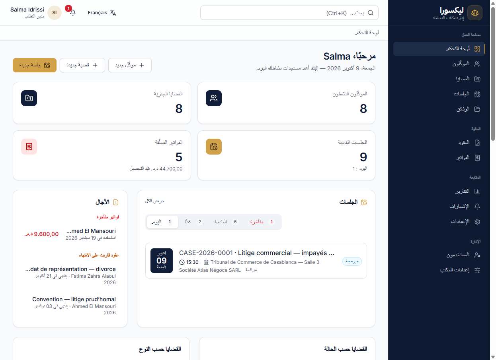
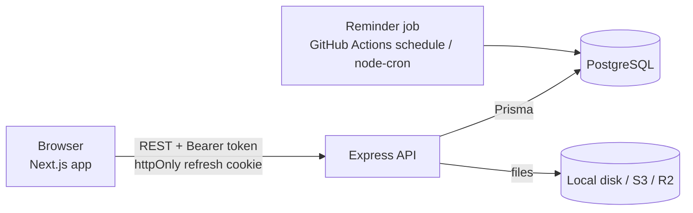

# Lexora — Law Firm Case Management Platform

> A lawyer should never lose a case because a hearing date was forgotten.

Lexora is a full-stack case management platform for law firms. It centralises clients, cases, hearings, documents,
contracts and invoices, and **automatically reminds every lawyer and assistant on a case 7, 3 and 1 days before each
hearing and on the day itself**, without duplicates. The interface is available in **French (LTR)** and
**Arabic (RTL)**.



## Features

| Area           | What it does                                                                                                                        |
| -------------- | ----------------------------------------------------------------------------------------------------------------------------------- |
| Dashboard      | Role-aware KPIs, today/tomorrow/upcoming/overdue hearings, deadlines (overdue invoices, expiring contracts), charts, recent activity |
| Clients        | CRUD, search, archive/restore, per-client cases, hearings, documents, contracts, invoices and timeline                              |
| Cases          | Reference generation, type/status/priority, court & opposing party, lead lawyer + assigned team, close/reopen, timeline             |
| Hearings       | List and month calendar in the firm timezone, quick filters (today, week, overdue), complete/postpone, automatic reminders          |
| Documents      | Secure upload (type/size checks), preview of PDFs/images, authenticated download, rename, linked to a case or a client              |
| Contracts      | Fee agreements with optional signed file, expiry tracking and alerts                                                                |
| Invoices       | Line items, tax, server-computed totals, draft/send, partial or full payments, cancel, printable invoice (browser "Save as PDF")    |
| Notifications  | In-app centre with unread badge; hearing reminders, contract expiry, invoices due/overdue — rendered in the user's language        |
| Reports        | Cases, hearings and revenue by period and lawyer, CSV export                                                                        |
| Administration | Users and roles (activate/deactivate), firm settings (currency, tax, due days, warning windows), manual reminder run               |
| Account        | Profile, password change (revokes other sessions), forgot/reset password                                                           |

**Roles** (enforced by the API, not only hidden in the UI):

| Role      | Access                                                                                                   |
| --------- | -------------------------------------------------------------------------------------------------------- |
| ADMIN     | Everything, including users and firm settings                                                            |
| LAWYER    | Their clients and the cases they lead or are assigned to; contracts, invoices and reports for those      |
| ASSISTANT | Only the cases they are assigned to (with their hearings, documents and clients); no finance, no admin   |

## Tech stack

| Layer    | Choice                                                                                                     |
| -------- | ---------------------------------------------------------------------------------------------------------- |
| Frontend | Next.js 15 (App Router), React 19, TypeScript (strict), Tailwind CSS 4, Radix UI, TanStack Query 5, React Hook Form + Zod 4, next-intl 4, Recharts 3, sonner |
| Backend  | Node.js 22, Express 5, TypeScript (strict), Prisma 6, Zod 4, JWT (access + rotating refresh), bcryptjs, multer, node-cron, nodemailer, AWS SDK v3 (S3/R2) |
| Database | PostgreSQL 16                                                                                              |
| Tests    | Jest + Supertest (API, against a real PostgreSQL), Jest + React Testing Library, Playwright (E2E)          |
| Ops      | Docker / docker-compose, GitHub Actions (CI + scheduled reminders), Vercel (frontend + `/api` proxy), Render (API), Neon (PostgreSQL) |

## Architecture



- Full description, auth sequence and reminder flow: [docs/architecture.md](docs/architecture.md)
- Data model and ER diagram: [docs/database.md](docs/database.md)
- REST endpoints: [docs/api.md](docs/api.md)
- Zero-cost deployment (Vercel / Render / Neon) and Docker: [docs/deployment.md](docs/deployment.md)

```
.
├── backend/            Express API (src/, prisma/, tests/)
├── frontend/           Next.js app (app/, components/, messages/, __tests__/, e2e/)
├── docs/               Architecture, database, API, deployment
├── docker-compose.yml  PostgreSQL + API + web
├── render.yaml         Render Free web service (reference; create the service manually)
└── .github/workflows/  CI and scheduled hearing reminders
```

## Getting started (local development)

**Prerequisites:** Node.js ≥ 20 (22 recommended), npm, and PostgreSQL 14+ (or Docker).

### 1. Database

Any PostgreSQL works. With Docker (choose a local password and reuse it in `DATABASE_URL`):

```bash
docker run -d --name legal-pg-dev -p 5440:5432 \
  -e POSTGRES_USER=legal -e POSTGRES_PASSWORD='<local password>' -e POSTGRES_DB=legal_management \
  postgres:16-alpine
docker exec legal-pg-dev createdb -U legal legal_management_test   # used by the backend tests
```

`DATABASE_URL=postgresql://legal:<local password>@localhost:5440/legal_management?schema=public`

### 2. Backend

```bash
cd backend
cp .env.example .env          # then set JWT_SECRET and JWT_REFRESH_SECRET (openssl rand -hex 48)
npm install
npx prisma migrate dev        # creates the schema
npm run db:seed               # demo data (development only)
npm run dev                   # http://localhost:5000  —  GET /health → {"status":"ok"}
```

### 3. Frontend

```bash
cd frontend
cp .env.example .env.local    # NEXT_PUBLIC_API_URL=http://localhost:5000
npm install
npm run dev                   # http://localhost:3000
```

If port 5000 is taken (e.g. macOS AirPlay), set `PORT=5050` in `backend/.env` and
`NEXT_PUBLIC_API_URL=http://localhost:5050` in `frontend/.env.local`.

### Or everything with Docker

```bash
cp .env.docker.example .env   # fill POSTGRES_PASSWORD, JWT_SECRET, JWT_REFRESH_SECRET
docker compose up -d --build
docker compose --profile seed run --rm seed
```

Web on http://localhost:3000, API on http://localhost:5000 (ports configurable in `.env`).

## Demo accounts

Created by `npm run db:seed` (development data only — never seed production):

| Role      | E-mail                  | Password    |
| --------- | ----------------------- | ----------- |
| Admin     | `admin@example.com`     | `Demo@2026` |
| Lawyer    | `lawyer@example.com`    | `Demo@2026` |
| Assistant | `assistant@example.com` | `Demo@2026` |

Set `SEED_PASSWORD` before seeding to use a different password. The seed also creates a second lawyer, eight clients,
cases with hearings spread around today (so reminders and the dashboard have data), documents, contracts and invoices.

## Environment variables

Templates: [`backend/.env.example`](backend/.env.example), [`frontend/.env.example`](frontend/.env.example),
[`.env.docker.example`](.env.docker.example). Real `.env` files are git-ignored.

| Variable                                  | App      | Purpose                                                                  |
| ----------------------------------------- | -------- | ------------------------------------------------------------------------ |
| `DATABASE_URL`                            | backend  | PostgreSQL connection string                                             |
| `JWT_SECRET`, `JWT_REFRESH_SECRET`        | backend  | ≥ 32 random characters each; the API refuses to start otherwise          |
| `JWT_ACCESS_EXPIRES_IN`, `REFRESH_TOKEN_TTL_DAYS` | backend | Token lifetimes (default 15m / 7 days)                         |
| `APP_URL`, `CORS_ORIGIN`                  | backend  | Frontend URL (reset links) and allowed origins                           |
| `APP_TIMEZONE`                            | backend  | Firm timezone for "today", reminders and overdue checks                  |
| `ALLOW_REGISTRATION`                      | backend  | Public self-registration of lawyer accounts                              |
| `UPLOAD_PROVIDER`, `UPLOAD_DIR`, `MAX_UPLOAD_MB` | backend | `local` or `s3`, local folder, size limit                        |
| `S3_BUCKET`, `S3_ENDPOINT`, `S3_REGION`, `UPLOAD_API_KEY`, `UPLOAD_API_SECRET` | backend | S3-compatible storage |
| `ENABLE_IN_PROCESS_SCHEDULER`, `REMINDER_CRON` | backend | Run reminders inside the API (instead of a cron job)              |
| `SMTP_*`                                  | backend  | Optional e-mail delivery (password reset)                                |
| `API_PROXY_TARGET`                        | frontend | API origin proxied as same-origin `/api` (build time; deployment on Vercel) |
| `NEXT_PUBLIC_API_URL`                     | frontend | Direct API base URL (build time; local dev, Docker) — ignored when `API_PROXY_TARGET` is set |
| `NEXT_PUBLIC_APP_TIMEZONE`                | frontend | Same value as `APP_TIMEZONE`                                             |
| `NEXT_PUBLIC_MAX_UPLOAD_MB`               | frontend | Client-side upload size check (same value as `MAX_UPLOAD_MB`)            |

Production fails fast when `DATABASE_URL`, `JWT_SECRET`, `JWT_REFRESH_SECRET`, `APP_URL` or `CORS_ORIGIN` (API) or
both `API_PROXY_TARGET` and `NEXT_PUBLIC_API_URL` (frontend build) are missing. Documents need S3 in production (`UPLOAD_PROVIDER=s3`); see
[docs/deployment.md](docs/deployment.md) for S3, SMTP, PostgreSQL and the first admin account.

## Scripts

| Command                 | backend                                   | frontend                          |
| ----------------------- | ----------------------------------------- | --------------------------------- |
| `npm run dev`           | API with reload (tsx)                     | Next.js dev server                |
| `npm run lint`          | ESLint                                    | ESLint                            |
| `npm run typecheck`     | `tsc --noEmit`                            | `tsc --noEmit`                    |
| `npm test`              | Jest + Supertest (needs PostgreSQL)       | Jest + React Testing Library      |
| `npm run build`         | Prisma client + `tsc`                     | `next build`                      |
| `npm start`             | Run the compiled API                      | Run the production build          |
| `npm run start:prod`    | Apply migrations, then start              | —                                 |
| `npm run job:reminders` | One-shot reminder job (cron)              | —                                 |
| `npm run db:seed`       | Demo data (wipes the database first)      | —                                 |
| `npm run admin:create`  | Create the first admin (`ADMIN_*` env)    | —                                 |
| `npm run test:e2e`      | —                                         | Playwright                        |

## Testing

```bash
# Backend: unit + integration tests against TEST_DATABASE_URL, or by default DATABASE_URL with "_test" appended
# to the database name (e.g. legal_management_test). The test database is wiped; never point it at real data.
cd backend && npm test

# Frontend: components, API client, invoice maths, translation parity (fr/ar keys and ICU arguments)
cd frontend && npm test

# End-to-end: needs the API (seeded) and the web app; running servers are reused, otherwise production builds are started
cd frontend
npm run test:e2e:install      # once: downloads Chromium
E2E_API_URL=http://localhost:5000 npm run test:e2e
```

`E2E_BASE_URL` (default `http://localhost:3000`) changes the web port; the API's `CORS_ORIGIN` must include it.

| Suite              | Coverage                                                                                                         |
| ------------------ | ---------------------------------------------------------------------------------------------------------------- |
| Backend (51 tests) | Auth (login, refresh rotation, concurrent refresh, reuse detection, logout, reset), RBAC and row-level scopes per role, clients, cases, hearings, documents (upload validation, download access), invoices (totals, payments, cancel), reminders (stages, idempotency, timezone), dashboard |
| Frontend (21 tests)| Form field accessibility and translated errors, badges, API client refresh/retry, invoice totals, date helpers, fr/ar message parity |
| E2E (12 tests)     | Invalid login, redirect to login and back, dashboard, role-based navigation, session kept on reload, logout, French LTR / Arabic RTL, create client → case → hearing → invoice |

CI ([.github/workflows/ci.yml](.github/workflows/ci.yml)) runs lint, typecheck, tests and build for both apps on every
push and pull request, then the Playwright suite against a freshly migrated and seeded database. It never deploys.

## Deployment

Zero-cost demo, no domain and no payment card required:

- **Frontend → Vercel Hobby**: root directory `frontend`, env `API_PROXY_TARGET=https://<service>.onrender.com`,
  `NEXT_PUBLIC_APP_TIMEZONE`, `NEXT_PUBLIC_MAX_UPLOAD_MB`. `/api/*` is proxied to Render, so the refresh cookie is
  first-party on the `vercel.app` domain.
- **API → Render Free web service** (created manually; `/health` check, `prisma migrate deploy` on start).
- **Database → Neon Free** (direct connection string, without `channel_binding`).
- **Documents → private S3-compatible bucket** (Backblaze B2 without card; Cloudflare R2 requires a payment method).
- **Reminders → GitHub Actions** ([`reminders.yml`](.github/workflows/reminders.yml), hourly, secret `DATABASE_URL`).
- Migrations and the first admin (`npm run admin:create`) or synthetic demo data are applied once from your PC — no
  Render Shell needed.

Step-by-step guide, environment variables, verification and troubleshooting: [docs/deployment.md](docs/deployment.md).

## Security

- Passwords hashed with bcrypt (cost 12); refresh and reset tokens stored as SHA-256 hashes; no secret or password ever
  returned by the API or written to logs.
- Short-lived access token in memory; refresh token in an `httpOnly`, `Secure` (production) cookie scoped to
  `/api/auth`, rotated on every use, with reuse detection.
- Authorization on every route (roles) and every query (row-level scopes); the frontend guards are UX only.
- Zod validation of every body and query (whitelisted sort fields, page size ≤ 100), consistent error format.
- Helmet, strict CORS, rate limiting (stricter on authentication), CSP and security headers on the frontend.
- Uploads: extension + MIME whitelist, size limit, random storage keys, files never served statically, downloads
  re-authorised and sent with `nosniff` and a sandboxing CSP.

## Decisions and trade-offs

| Decision                         | Reason                                                                                                     |
| -------------------------------- | ---------------------------------------------------------------------------------------------------------- |
| `bcryptjs` instead of `bcrypt`   | Pure JavaScript: no native build on Windows, Alpine or Render; same algorithm and hash format              |
| Prisma pinned to 6.x             | Prisma 7 changes configuration and client generation; 6.19 is stable and well supported                   |
| Locale in a cookie, no `/fr` `/ar` URL prefix | Simpler routing for an authenticated back-office app; `lang`/`dir` set on `<html>`             |
| Invoice PDF via the print page   | The printable invoice uses print CSS ("Save as PDF") instead of a server-side PDF engine (no headless Chrome on the API) |
| Reminders as an idempotent job   | Works with a GitHub Actions schedule, node-cron or a manual trigger; unique `dedupeKey` prevents duplicates |
| Same-origin `/api` proxy on Vercel | First-party refresh cookie on free `*.vercel.app` / `*.onrender.com` domains, no custom domain needed     |
| Files outside PostgreSQL         | Only metadata in the database; content on disk (dev/Docker) or S3/R2 (production)                         |

## Limitations

- E-mail notifications are limited to password resets; hearing reminders are in-app only (an SMTP/SMS channel can be
  plugged into the notification service).
- No real-time push: the notification badge polls every 60 seconds.
- Free demo hosting: the Render API sleeps after 15 idle minutes (first request ~1 minute), rate limits are shared by
  visitors behind the Vercel proxy, and scheduled reminders can be delayed by GitHub.
- Invoices are exported as PDF through the browser print dialog, not generated server-side.
- Single firm (single tenant) per deployment.

## License

Proprietary — all rights reserved unless stated otherwise by the repository owner.
