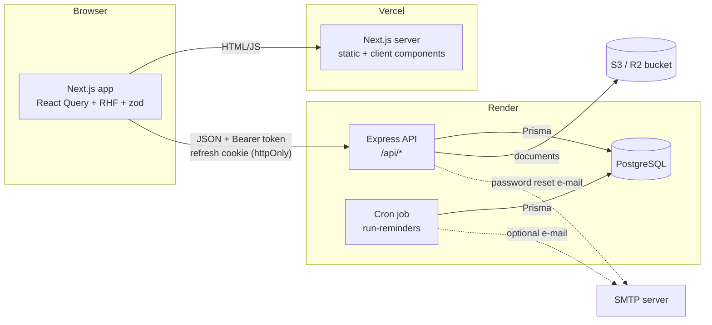
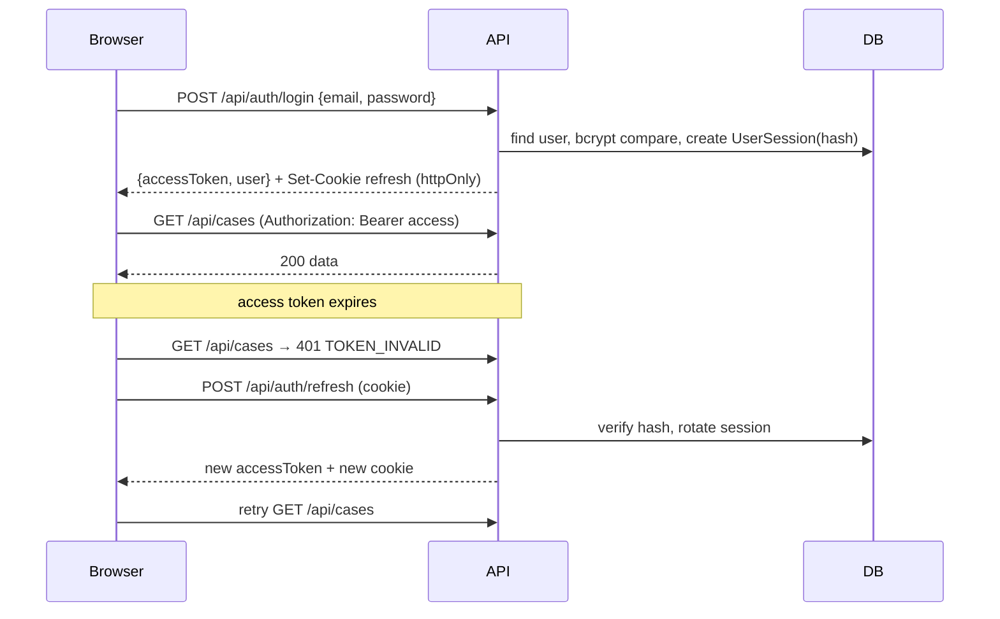
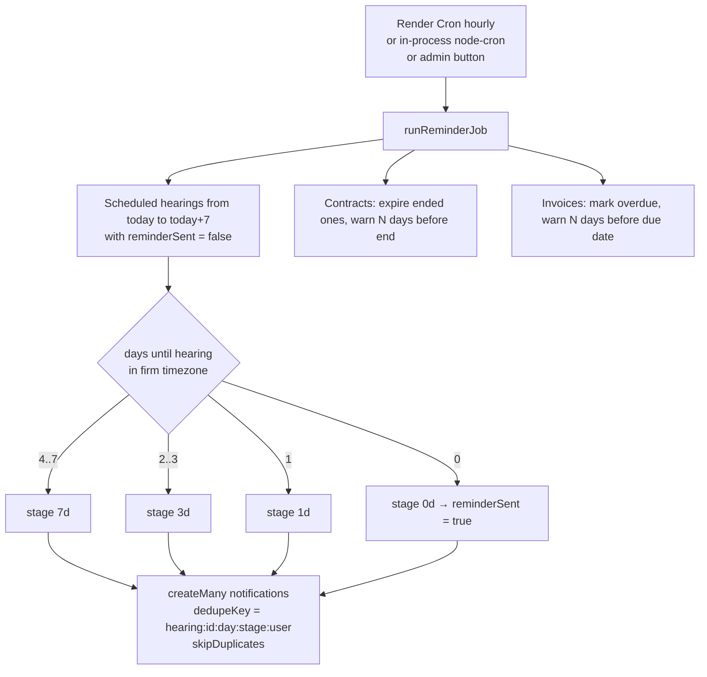

# Architecture

The platform is split into two independently deployable applications that talk over a JSON REST API.

| Layer    | Technology                                                                 | Hosting            |
| -------- | -------------------------------------------------------------------------- | ------------------ |
| Frontend | Next.js 15 (App Router), React 19, TypeScript, Tailwind CSS 4, next-intl 4 | Vercel             |
| Backend  | Node.js 22, Express 5, TypeScript, Prisma 6, Zod 4                         | Render web service |
| Database | PostgreSQL 16                                                              | Render PostgreSQL  |
| Jobs     | Same backend code, `npm run job:reminders`                                 | Render Cron Job    |
| Files    | Local disk (development / Docker) or any S3-compatible bucket (production) | Cloudflare R2, S3… |



## Backend layout (`backend/src`)

| Folder        | Responsibility                                                                                    |
| ------------- | ------------------------------------------------------------------------------------------------- |
| `config/`     | Validated environment (`env.ts`, fails fast), Prisma client, structured logger                     |
| `routes/`     | Route table; attaches `authenticate` and `authorize(...roles)` middlewares                        |
| `controllers/`| Parse/validate input with Zod, call a service, send the standard response                         |
| `validators/` | Zod schemas for bodies and query strings (whitelisted sort fields, max page size 100)            |
| `services/`   | Business rules, row-level scopes (`access.service.ts`), activity log, notifications, reminders    |
| `storage/`    | `StorageProvider` interface with `local` and `s3` implementations                                |
| `middleware/` | JWT authentication, role authorization, rate limiting, upload (multer, type/size checks), errors |
| `jobs/`       | `run-reminders.ts` (one-shot, for Render Cron) and `scheduler.ts` (optional in-process node-cron)  |
| `utils/`      | Response helpers, pagination, dates in the firm timezone, invoice maths, sequences, crypto       |

## Frontend layout (`frontend`)

| Folder               | Responsibility                                                                      |
| -------------------- | ----------------------------------------------------------------------------------- |
| `app/`               | Routes: public pages, `(auth)` pages, `dashboard/*` protected area                   |
| `components/ui/`     | Design-system primitives (Radix-based buttons, dialogs, inputs, tabs…)              |
| `components/shared/` | Data table, pagination, search select, page header, states, confirm dialog, badges |
| `components/<module>`| Module forms and widgets (clients, cases, hearings, documents, invoices…)          |
| `services/`          | Typed API client (`api-client.ts`) and resource services                            |
| `hooks/`             | List state in the URL, notifications, formatting, error mapping                     |
| `messages/`          | `fr.json` and `ar.json`: every UI string (a unit test enforces key parity)           |

## Authentication flow

Access tokens are short-lived JWTs (15 min) kept **in memory** only. The refresh token is a random value stored
as an `httpOnly` cookie scoped to `/api/auth`; only its SHA-256 hash is stored in `UserSession`. Each refresh
rotates the token; reusing a revoked token revokes the session.



Concurrent 401s share one in-flight refresh. On page load the app calls `/api/auth/refresh` to restore the session.

Rotation is atomic (the session row is updated only if it still holds the presented hash). Requests that present the
same token within 30 seconds (two tabs, a reload during a refresh, React strict mode) receive the **same** new token
instead of triggering reuse detection; outside that window, a rotated token revokes the session. The grace window is
kept in memory per API instance: with several instances, a concurrent duplicate may still end the session (the user
signs in again), which errs on the safe side.

## Authorization

Authorization is enforced **on the backend** at two levels:

1. **Role guards** on routes (`authorize('ADMIN', 'LAWYER')`): user management and firm settings are ADMIN only;
   contracts, invoices and reports are ADMIN + LAWYER; creating clients and cases is ADMIN + LAWYER.
2. **Row-level scopes** (`access.service.ts`) merged into every Prisma query:
   - ADMIN: everything.
   - LAWYER: cases they lead or are assigned to, and the related clients, hearings, documents, contracts, invoices.
   - ASSISTANT: only cases they are assigned to (and their hearings/documents/clients).

The frontend hides links and buttons with `RoleGate` / `hasRole`, purely for UX.

## Hearing reminder flow



- Recipients: the case's lead lawyer and every assigned user.
- **No duplicates**: each notification carries a unique `dedupeKey`, inserted with `skipDuplicates`, so running the
  job every hour (or several times) never produces a second reminder for the same stage.
- A hearing created or rescheduled inside the 7-day window is evaluated immediately, so it gets the closest stage at once.
- Moving a hearing to another day produces a new key (the day is part of it), so reminders restart for the new date.
- Notifications store structured `data`, so the UI renders them in the user's language.

## Documents

Uploads go through `multer` memory storage with an extension + MIME whitelist (PDF, Office, images, text) and a size
limit (`MAX_UPLOAD_MB`). Files are written by the storage provider under a random key; the database keeps only
metadata (`fileUrl` is a storage key, never a public URL). Downloads go through `GET /api/documents/:id/download`,
which re-checks access before streaming the file with `Content-Disposition: attachment` and `nosniff`.

## API response format

```json
{ "success": true, "data": {}, "meta": { "page": 1, "pageSize": 10, "total": 42, "totalPages": 5 } }
{ "success": false, "message": "Validation failed", "errorCode": "VALIDATION_ERROR", "details": [] }
```

## Internationalisation

next-intl without locale-prefixed routes: the locale (`fr` default, `ar`) is stored in the `NEXT_LOCALE` cookie and
read in `i18n/request.ts`. The root layout sets `lang` and `dir` (`rtl` for Arabic); layouts use logical
CSS properties (`ms-*`, `pe-*`, `start/end`) so they mirror automatically. Dates, numbers and money are formatted
with `Intl` in the firm timezone (`APP_TIMEZONE`).
