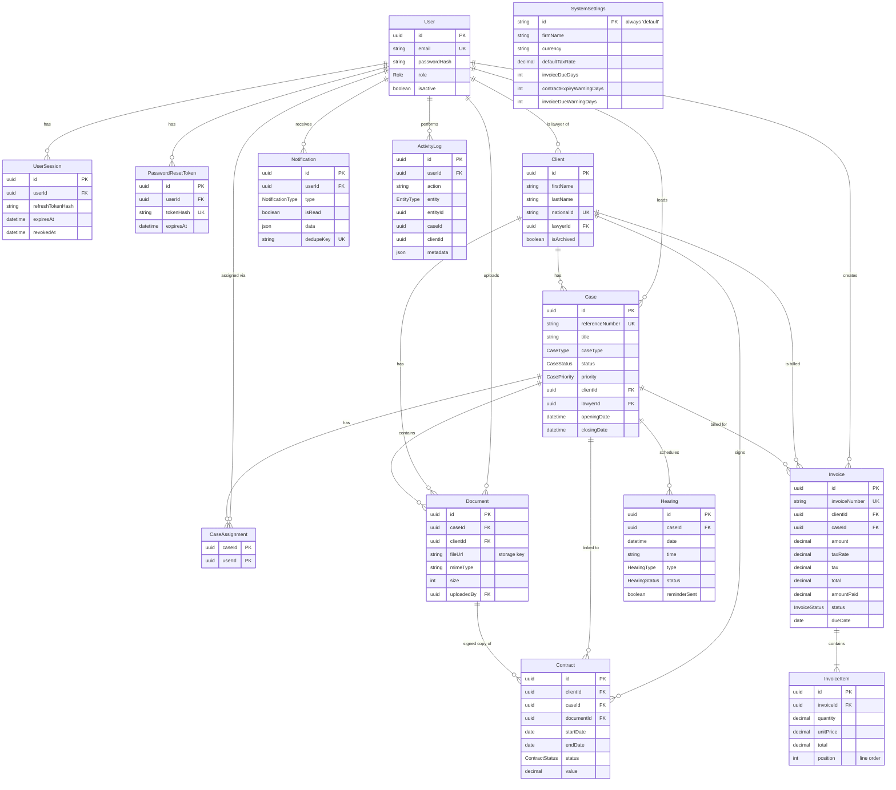

# Database

PostgreSQL 16, managed with Prisma 6 (`backend/prisma/schema.prisma`, migrations in `backend/prisma/migrations`).
All primary keys are UUIDs; money uses `Decimal(12,2)`; timestamps are stored in UTC.

## Entity-relationship diagram



## Key design decisions

| Topic               | Decision                                                                                                                                  |
| ------------------- | ----------------------------------------------------------------------------------------------------------------------------------------- |
| Case references     | Optional on create; otherwise generated as `CASE-YYYY-NNNN` (yearly sequence). Unique.                                                     |
| Invoice numbers     | Generated server-side as `INV-YYYY-NNNN`. Unique.                                                                                         |
| Invoice totals      | Always recomputed on the server from the items and tax rate (client values are ignored). Paid/partial status derived from `amountPaid`. |
| Client deletion     | `DELETE` **archives** the client (`isArchived`, restorable). Permanent deletion is admin-only and refused while cases or invoices exist. |
| Referential actions | `Restrict` for case → client/lawyer and invoice → client (no silent data loss); `Cascade` for hearings, assignments, invoice items.       |
| Files               | Only metadata in PostgreSQL. Binary content lives on disk (`UPLOAD_DIR`) or in an S3 bucket.                                              |
| Secrets             | Passwords hashed with bcrypt (cost 12); refresh and reset tokens stored as SHA-256 hashes only.                                          |
| Reminder idempotency| `Notification.dedupeKey` unique + `createMany({ skipDuplicates: true })`.                                                                 |
| Timeline            | `ActivityLog` rows are denormalised with `caseId`/`clientId` for fast case and client timelines.                                          |
| Indexes             | On foreign keys, status/date pairs used by dashboards and jobs (`Hearing(status,date)`, `Invoice(status,dueDate)`, `Contract(status,endDate)`), and search columns. |

## Commands

```bash
cd backend
npx prisma migrate dev        # create/apply a migration in development
npx prisma migrate deploy     # apply migrations in production (run by `npm run start:prod`)
npm run db:seed               # demo data (development only)
npm run db:reset              # drop, re-migrate and re-seed (development only)
npx prisma studio             # browse data
```
