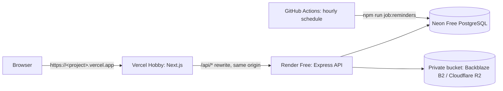

# Deployment — zero-cost demo

Selected architecture: **Vercel Hobby** (frontend) · **Render Free web service** (API) · **Neon Free** (PostgreSQL) ·
**S3-compatible private bucket** (documents) · **GitHub Actions schedule** (hearing reminders). No paid domain, no
payment card, no paid resource. CI only verifies; it never deploys.



**Same-origin `/api` proxy.** The browser only talks to `https://<project>.vercel.app`. Vercel rewrites `/api/*` to the
Render service (`API_PROXY_TARGET`, read at build time). The refresh cookie (`lm_refresh`, `HttpOnly; Secure;
Path=/api/auth`) is therefore first-party on the Vercel domain: it works in every browser, including Safari, without a
custom domain. The API sends `Cache-Control: no-store` on `/api` and the frontend disables Vercel rewrite caching.

> **Document storage and the "no card" rule.** Cloudflare R2 asks for a payment method (card or PayPal) before the
> R2 service can be enabled, even on its free tier. This guide therefore stops before that step and uses
> **Backblaze B2** (10 GB free, no card), which is S3-compatible and uses the same environment variables. If you add a
> payment method to Cloudflare yourself, follow [§3b](#3b-cloudflare-r2-only-if-you-accept-adding-a-payment-method).

## Free-tier limits you accept

| Service      | Limit (check current pages before relying on them)                                                       |
| ------------ | --------------------------------------------------------------------------------------------------------- |
| Vercel Hobby | Personal, **non-commercial** use only. External rewrites time out after 120 s.                            |
| Render Free  | Sleeps after 15 min without traffic; the first request after that waits about 1 minute. No shell, no disk, 750 instance-hours/month. Suspended, never billed, when limits are reached. |
| Neon Free    | Small storage and compute quota; the database suspends when idle (first query a bit slower).             |
| Backblaze B2 | 10 GB stored; daily download/transaction caps without a card (requests are refused, never billed).       |
| GitHub Actions | Free on public repositories. Schedules can be delayed, run only on the default branch, and are disabled after 60 days without repository activity. |

## 0. Accounts (all free, no card)

1. **GitHub**: already set up — [marwanbarhoumi/lawyer-case-management-platform](https://github.com/marwanbarhoumi/lawyer-case-management-platform).
2. **Neon**: <https://neon.tech> → Sign up with GitHub. Plan **Free**.
3. **Render**: <https://render.com> → Get Started → Sign up with GitHub. Do **not** add a card.
4. **Vercel**: <https://vercel.com/signup> → plan **Hobby** → Continue with GitHub.
5. **Backblaze B2**: <https://www.backblaze.com/sign-up/cloud-storage> → choose region **EU Central** → verify the
   e-mail. Do not enter billing information.

Requirements on your PC: Node.js 22 and this repository (`git pull`).

## 1. Neon database

1. Neon → **Create project**: name `lexora`, Postgres 16 or 17, region **AWS Europe Central 1 (Frankfurt)** (same
   region as the Render service).
2. **Connect** → turn **Connection pooling off** (direct connection; Prisma migrations need it) → copy the connection
   string. It looks like:
   `postgresql://<user>:<password>@ep-xxxx.eu-central-1.aws.neon.tech/neondb?sslmode=require&channel_binding=require`
3. Edit it: **delete `&channel_binding=require`** (Prisma 6 cannot use it) and append `&connect_timeout=15` (lets the
   suspended database wake up):
   `postgresql://<user>:<password>@ep-xxxx.eu-central-1.aws.neon.tech/neondb?sslmode=require&connect_timeout=15`

This final string is **`DATABASE_URL`** everywhere below. Keep it in a password manager; never commit or paste it in
an issue.

## 2. Initialise the database from your PC (no Render Shell needed)

Render Free has no shell, so the schema and the first administrator are created once from your PC. Use a **new**
PowerShell window; the variables live only in that window.

```powershell
cd "D:\Lawyer Case Management Platform\backend"
npm ci
npm run build

# Paste the Neon DATABASE_URL (from §1); Read-Host input is not saved in the PowerShell history.
$env:DATABASE_URL = Read-Host "Neon DATABASE_URL"

# Must print the Neon host (ep-....neon.tech), NOT localhost.
npx prisma migrate status
npx prisma migrate deploy        # creates the tables; never use "migrate reset"
```

Then choose **one** of the two options.

### Option A — first administrator only (empty application)

```powershell
$env:JWT_SECRET = node -e "console.log(require('crypto').randomBytes(48).toString('hex'))"          # throwaway,
$env:JWT_REFRESH_SECRET = node -e "console.log(require('crypto').randomBytes(48).toString('hex'))"  # only to load the config
$env:ADMIN_EMAIL = Read-Host "Admin e-mail"
$env:ADMIN_FIRST_NAME = Read-Host "First name"
$env:ADMIN_LAST_NAME = Read-Host "Last name"
$env:ADMIN_PASSWORD = [Net.NetworkCredential]::new('', (Read-Host "Admin password" -AsSecureString)).Password
npm run admin:create             # {"message":"Administrator created", ...}
```

The password needs 8 to 128 characters with at least one letter and one digit (use a long, unique one). The command only adds an `ADMIN`
user and refuses an existing e-mail.

### Option B — synthetic demo data (fictitious clients, cases, hearings, invoices, documents)

Only on the **new, empty** Neon database: the seed **deletes all data** first. It creates three accounts —
`admin@example.com`, `lawyer@example.com`, `assistant@example.com` — with the password you choose (never keep the
public default `Demo@2026` on the internet). Its demo PDFs go to the bucket, so do §3 first and set the same storage
variables as on Render:

```powershell
$env:JWT_SECRET = node -e "console.log(require('crypto').randomBytes(48).toString('hex'))"
$env:JWT_REFRESH_SECRET = node -e "console.log(require('crypto').randomBytes(48).toString('hex'))"
$env:UPLOAD_PROVIDER = "s3"
$env:S3_BUCKET = Read-Host "Bucket name"
$env:S3_ENDPOINT = Read-Host "S3 endpoint (https://...)"
$env:S3_REGION = Read-Host "S3 region"
$env:UPLOAD_API_KEY = Read-Host "Key ID"
$env:UPLOAD_API_SECRET = [Net.NetworkCredential]::new('', (Read-Host "Application key" -AsSecureString)).Password
$env:SEED_PASSWORD = [Net.NetworkCredential]::new('', (Read-Host "Demo accounts password" -AsSecureString)).Password
npm run db:seed
```

You can run Option A afterwards to add your own administrator. **Close the PowerShell window** when done (it erases the
variables). Without `$env:DATABASE_URL` the scripts would use your local `backend/.env` database instead — that is why
`prisma migrate status` must show the Neon host first.

## 3. Document storage

### 3a. Backblaze B2 (selected — no card)

1. B2 → **Buckets → Create a Bucket**: unique name (e.g. `lexora-docs-<random>`), Files in Bucket: **Private**,
   encryption: enable (SSE-B2), Object Lock: disabled → Create.
2. Note the bucket **Endpoint**, e.g. `s3.eu-central-003.backblazeb2.com`. Then:
   - `S3_ENDPOINT` = `https://s3.eu-central-003.backblazeb2.com`
   - `S3_REGION` = `eu-central-003` (the part between `s3.` and `.backblazeb2.com`)
   - `S3_BUCKET` = the bucket name
3. **Application Keys → Add a New Application Key**: name `lexora-api`, allow access to **this bucket only**, type
   **Read and Write** → Create. Copy immediately (shown once):
   - `keyID` → `UPLOAD_API_KEY`
   - `applicationKey` → `UPLOAD_API_SECRET`

   Never use the master application key.

### 3b. Cloudflare R2 (only if you accept adding a payment method)

Cloudflare dashboard → **R2 Object Storage**. Cloudflare asks for a payment method here: **this is where this guide
stops** under the no-card rule. If you choose to continue yourself: create a bucket (no public access, no custom
domain), then **Manage API tokens → Create API token** with **Object Read & Write** limited to that bucket. Values:
`S3_ENDPOINT=https://<account-id>.r2.cloudflarestorage.com`, `S3_REGION=auto`, `UPLOAD_API_KEY` = Access Key ID,
`UPLOAD_API_SECRET` = Secret Access Key. Stay below the free-tier quotas.

Either way the bucket stays private: the API stores only the object key and streams downloads after checking the
user's permissions.

## 4. API on Render (Free web service, created manually)

Do not use **New → Blueprint** (it can create paid resources if the file changes). [`render.yaml`](../render.yaml)
only documents the free service.

1. Choose your Vercel project name now (e.g. `lexora-demo`) — the frontend URL will be
   `https://lexora-demo.vercel.app`. Check that it is free in §5 step 1 if unsure.
2. Generate two secrets locally (prints random values; paste them into Render, do not save them in a file):

   ```powershell
   node -e "console.log(require('crypto').randomBytes(48).toString('hex'))"   # JWT_SECRET
   node -e "console.log(require('crypto').randomBytes(48).toString('hex'))"   # JWT_REFRESH_SECRET (different)
   ```

3. Render → **New → Web Service** → **Git Provider → GitHub** → authorise Render for the repository
   `lawyer-case-management-platform` → **Connect**.
4. Settings:

| Field            | Value                                     |
| ---------------- | ----------------------------------------- |
| Name             | `lexora-api` (URL `https://lexora-api.onrender.com`; Render may add a suffix) |
| Language         | Node                                      |
| Branch           | `main`                                    |
| Region           | Frankfurt (EU Central)                    |
| Root Directory   | `backend`                                 |
| Build Command    | `npm ci --include=dev && npm run build`   |
| Start Command    | `npm run start:prod`                      |
| Instance Type    | **Free** — never select a paid type       |
| Health Check Path (Advanced) | `/health`                     |
| Auto-Deploy      | On commit                                 |

5. **Environment Variables** (Add Environment Variable for each):

| Key                          | Value                                                          |
| ---------------------------- | -------------------------------------------------------------- |
| `NODE_ENV`                   | `production`                                                   |
| `NODE_VERSION`               | `22`                                                           |
| `DATABASE_URL`               | Neon string from §1                                            |
| `JWT_SECRET`                 | first generated value                                          |
| `JWT_REFRESH_SECRET`         | second generated value                                         |
| `APP_URL`                    | `https://lexora-demo.vercel.app` (your Vercel URL, no trailing `/`) |
| `CORS_ORIGIN`                | same as `APP_URL`                                              |
| `APP_TIMEZONE`               | `Africa/Tunis`                                                 |
| `ALLOW_REGISTRATION`         | `false`                                                        |
| `UPLOAD_PROVIDER`            | `s3`                                                           |
| `S3_BUCKET`, `S3_ENDPOINT`, `S3_REGION` | from §3                                             |
| `UPLOAD_API_KEY`, `UPLOAD_API_SECRET`   | from §3                                             |
| `MAX_UPLOAD_MB`              | `10`                                                           |
| `ENABLE_IN_PROCESS_SCHEDULER` | `false` (reminders run from GitHub Actions)                   |
| `SMTP_HOST`, `SMTP_PORT`, `SMTP_USER`, `SMTP_PASSWORD`, `SMTP_FROM` | optional, for password-reset e-mails (e.g. Brevo free plan, port 587) |

6. **Deploy Web Service**. The start command runs `prisma migrate deploy` (no-op if §2 already applied the migrations)
   then the server. Wait for "Your service is live".
7. Check `https://<service>.onrender.com/health` → `{"status":"ok"}` and `/health/ready` →
   `{"status":"ok","database":"ok"}`.

The API refuses to start if `DATABASE_URL`, the JWT secrets (≥ 32 characters), `APP_URL` or `CORS_ORIGIN` are missing
or if `UPLOAD_PROVIDER=s3` has no bucket/key: read the Render **Logs** tab.

## 5. Frontend on Vercel (Hobby)

1. Vercel → **Add New… → Project** → Import `lawyer-case-management-platform` (install the Vercel GitHub app for that
   repository if asked).
2. Settings:

| Field            | Value                                         |
| ---------------- | --------------------------------------------- |
| Project Name     | `lexora-demo` (the name chosen in §4)         |
| Framework Preset | Next.js                                       |
| Root Directory   | `frontend`                                    |
| Build / Install / Output | defaults                              |

3. **Environment Variables** (all environments):

| Key                         | Value                                                         |
| --------------------------- | ------------------------------------------------------------- |
| `API_PROXY_TARGET`          | `https://<service>.onrender.com` (origin only: no path, no trailing `/`) |
| `NEXT_PUBLIC_APP_TIMEZONE`  | `Africa/Tunis`                                                |
| `NEXT_PUBLIC_MAX_UPLOAD_MB` | `10`                                                          |

   Do **not** set `NEXT_PUBLIC_API_URL` (it would bypass the proxy and make the cookie third-party).
4. **Deploy**. Then Settings → **Domains**: the production domain must be exactly the `APP_URL` set on Render. If Vercel
   assigned another name, update `APP_URL` and `CORS_ORIGIN` on Render (Render redeploys automatically).
5. Settings → General → **Node.js Version** `22.x` (redeploy if changed).

`API_PROXY_TARGET` is read at **build time**: redeploy Vercel after changing it. Preview deployments use other
`*.vercel.app` hosts that are not in `CORS_ORIGIN`, so login is refused there (403) — use the production URL, or add a
preview origin to `CORS_ORIGIN` (comma-separated) temporarily.

## 6. Hearing reminders (GitHub Actions)

[`.github/workflows/reminders.yml`](../.github/workflows/reminders.yml) runs `npm run job:reminders` every hour
(minute 17) and on demand. The job is idempotent (unique key per hearing / stage / user), so delayed, repeated or manual
runs never duplicate reminders (7, 3 and 1 days before, and on the day).

1. GitHub → repository → **Settings → Secrets and variables → Actions → New repository secret**: `DATABASE_URL` = the
   Neon string. (Or from the repository folder: `gh secret set DATABASE_URL`, then paste — the value is not echoed.)
2. Optional, **Variables** tab: `APP_TIMEZONE` (default `Africa/Tunis`, keep it equal to Render's).
3. **Actions → Hearing reminders → Run workflow** once; the log ends with `"message":"Reminder job finished"` and the counts. Without the secret
   the workflow skips with a notice instead of failing.

The workflow generates throwaway JWT values (the job never signs tokens) and has read-only repository permissions.
Push at least one commit every 60 days or GitHub disables the schedule (re-enable it from the Actions tab).

## 7. Verification (production URL)

1. `https://<service>.onrender.com/health` → `{"status":"ok"}` (wait up to a minute if it was asleep).
2. `https://<project>.vercel.app` → redirected to `/login`; sign in with the account from §2.
3. Reload the dashboard: the session is kept. Sign out: protected pages redirect to `/login`.
4. DevTools → Application → Cookies → `https://<project>.vercel.app`: `lm_refresh` is `HttpOnly`, `Secure`,
   path `/api/auth`. DevTools → Network: all API calls go to `/api/...` on the Vercel domain, no CORS error.
5. Switch to Arabic (RTL) and back to French (LTR).
6. Create a client, a case, a hearing for tomorrow and an invoice; upload a PDF, download it, delete it.
7. Run **Hearing reminders** (§6) and check the notification for tomorrow's hearing; run it again: no duplicate.

## 8. Operating notes

- **Migrations**: committed in `backend/prisma/migrations`, applied by `prisma migrate deploy` on every Render start
  (applies only missing migrations, never drops data). Never run `prisma migrate reset`, `db push --force-reset` or
  `npm run db:seed` against a database with real data. New schema change: create the migration locally
  (`npm run prisma:migrate -- --name <change>`), commit, push.
- **Rate limiting behind the proxy**: the API trusts one proxy hop, so it sees Vercel's egress addresses rather than
  each visitor. Limits (login 30 / 15 min, refresh 300, API 1000 per address) are shared by visitors arriving through
  the same Vercel egress — acceptable for a demo, cannot be bypassed by spoofing `X-Forwarded-For`.
- **Uploads**: 10 MB maximum (`MAX_UPLOAD_MB`); files stream through Vercel to Render to the bucket.
- **Backups**: Neon Free keeps a short restore window; export important data with `pg_dump "<DATABASE_URL>"` if needed.
- **Secrets rotation**: changing `JWT_REFRESH_SECRET` on Render signs everybody out; `DATABASE_URL` must be changed on
  Render and in the GitHub secret.

## Troubleshooting

| Symptom                                               | Cause / fix                                                                           |
| ----------------------------------------------------- | ------------------------------------------------------------------------------------- |
| First page load takes ~1 minute                       | Render Free was asleep (normal). Vercel waits up to 120 s.                            |
| Login returns 403 `CORS_REJECTED`                     | `CORS_ORIGIN` on Render ≠ the exact Vercel URL (scheme, host, no trailing `/`), or a preview URL |
| Login returns 404 / HTML                              | `API_PROXY_TARGET` missing or wrong on Vercel, or Vercel not redeployed after setting it |
| Frontend build fails: `Set API_PROXY_TARGET ...`      | Add `API_PROXY_TARGET` in Vercel (all environments) and redeploy                     |
| Frontend build fails: `API_PROXY_TARGET must be an origin` | Remove any path or trailing `/` (`https://x.onrender.com`)                       |
| Prisma `P1013` / invalid database string              | Remove `channel_binding=require` from `DATABASE_URL`                                 |
| Prisma `P1001` / timeout                              | Use the direct (non-`-pooler`) Neon host, keep `sslmode=require&connect_timeout=15` |
| API exits: `Invalid environment configuration`        | A variable is missing or a secret is shorter than 32 characters (log lists it)      |
| API exits: `Missing production configuration`         | Set `APP_URL` and `CORS_ORIGIN` on Render                                            |
| Upload returns 500                                    | Wrong `S3_ENDPOINT` / `S3_REGION` / bucket, or key without write access to the bucket |
| `migrate status` shows `localhost`                    | `$env:DATABASE_URL` not set in this PowerShell window — stop, set it, re-check      |
| Hearing reminders workflow "skipped"                  | `DATABASE_URL` repository secret missing                                             |

## Other targets

- **Docker / self-hosting** (full stack with PostgreSQL and in-process scheduler):
  `cp .env.docker.example .env` (set `POSTGRES_PASSWORD`, `JWT_SECRET`, `JWT_REFRESH_SECRET`), then
  `docker compose up -d --build`; optional demo data `docker compose --profile seed run --rm seed` (wipes the Docker
  database). `docker compose down` keeps the volumes; `down -v` deletes them.
- **Separate API domain** (paid plans or a custom domain): build the frontend with `NEXT_PUBLIC_API_URL=https://api.<domain>`
  instead of `API_PROXY_TARGET`; put both apps on subdomains of the same domain so the cookie stays first-party.
