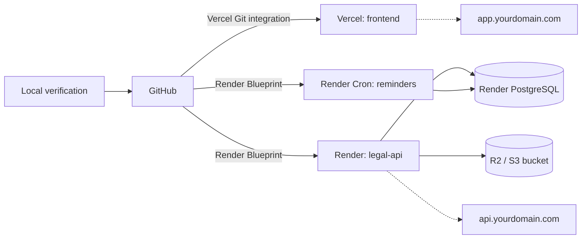

# Deployment

Target setup: **frontend on Vercel**, **API + PostgreSQL + reminder cron on Render**, documents in an
**S3-compatible bucket** (Cloudflare R2, AWS S3, Backblaze B2…). CI only verifies; it never deploys.



Order: **local → GitHub → Vercel → Render → PostgreSQL → custom domain → production verification**.

## 0. Before you start

- Accounts: GitHub, Vercel, Render, an S3-compatible bucket (R2 has a free tier), optionally an SMTP provider.
- A domain you control (needed for reliable cookies, see [§6](#6-custom-domain-and-dns)).
- Costs: `render.yaml` uses paid Render plans on purpose — cron jobs have no free tier, free web services sleep (cold
  starts, reminders missed) and free PostgreSQL databases expire. See [§8](#8-reminders) for free alternatives to the
  cron job. Check current prices on Render before applying the Blueprint.

## 1. Local verification

```bash
cd backend  && npm ci && npm run lint && npm run typecheck && npm test && npm run build
cd frontend && npm ci && npm run lint && npm run typecheck && npm test && npm run build
cd frontend && npm run test:e2e          # API seeded + web app (see README "Testing")
```

## 2. GitHub

The repository is [github.com/marwanbarhoumi/lawyer-case-management-platform](https://github.com/marwanbarhoumi/lawyer-case-management-platform)
(branch `main`). For a fork or a new copy:

```bash
gh repo create <owner>/<name> --private --source . --push     # or create it on github.com, then:
git remote add origin https://github.com/<owner>/<name>.git && git push -u origin main
```

`.gitignore` excludes `.env*` (except the `*.example` templates), `node_modules`, build output, uploads, logs and test
reports. Check `git status` before every commit. CI ([.github/workflows/ci.yml](../.github/workflows/ci.yml)) runs on
push and pull requests and needs no secret.

## 3. Frontend on Vercel

1. Vercel → **Add New → Project** → import the GitHub repository.
2. Settings:

| Setting          | Value                                   |
| ---------------- | --------------------------------------- |
| Root Directory   | `frontend`                              |
| Framework preset | Next.js (detected)                      |
| Install command  | default (`npm install`) or `npm ci`     |
| Build command    | `npm run build`                         |
| Output directory | default (`.next`)                       |
| Node.js version  | 22.x                                    |

3. Environment variables (Production and Preview):

| Variable                    | Value                                                                    |
| --------------------------- | ------------------------------------------------------------------------ |
| `NEXT_PUBLIC_API_URL`       | API URL without trailing `/`, e.g. `https://api.yourdomain.com` (required) |
| `NEXT_PUBLIC_APP_TIMEZONE`  | Same as the API `APP_TIMEZONE` (e.g. `Africa/Tunis`)                 |
| `NEXT_PUBLIC_MAX_UPLOAD_MB` | Same as the API `MAX_UPLOAD_MB` (default 10)                              |

`NEXT_PUBLIC_*` values are inlined at **build time** and `NEXT_PUBLIC_API_URL` is also written into the
Content-Security-Policy `connect-src`: redeploy the frontend after changing them. A production build fails if
`NEXT_PUBLIC_API_URL` is missing, so a deployment can never silently call `localhost`.

## 4. Backend and PostgreSQL on Render

### Blueprint (recommended)

1. Render → **New → Blueprint** → select the repository. [`render.yaml`](../render.yaml) creates:
   - `legal-db` — PostgreSQL 16 (`DATABASE_URL` injected into the services);
   - `legal-api` — web service, `rootDir: backend`, build `npm ci --include=dev && npm run build`
     (includes `prisma generate`), start `npm run start:prod` (`prisma migrate deploy`, then the server), health check
     `GET /health` → `{"status":"ok"}`;
   - `legal-hearing-reminders` — cron job `npm run job:reminders`, every hour.
2. `JWT_SECRET` and `JWT_REFRESH_SECRET` are generated by Render; the cron job reads them from the web service.
3. Fill the variables marked `sync: false`:

| Variable                                               | Value                                                                       |
| ------------------------------------------------------ | --------------------------------------------------------------------------- |
| `APP_URL`                                              | Frontend URL, e.g. `https://app.yourdomain.com` (password-reset links)      |
| `CORS_ORIGIN`                                          | Frontend origin(s), comma-separated, no `*`; **required** in production      |
| `S3_BUCKET`, `S3_ENDPOINT`                             | Bucket and endpoint (R2: `https://<account>.r2.cloudflarestorage.com`)      |
| `UPLOAD_API_KEY`, `UPLOAD_API_SECRET`                  | Bucket access key id / secret (bucket stays private)                        |
| `SMTP_HOST`, `SMTP_USER`, `SMTP_PASSWORD`, `SMTP_FROM` | Optional; needed for password-reset e-mails (`SMTP_PORT` defaults to 587)   |

4. Apply. Migrations run on every start with `prisma migrate deploy` (never `migrate reset`, which would erase data).
5. Check `https://<service>.onrender.com/health` → `{"status":"ok"}` and `/health/ready` → database `ok`.

The API refuses to start with an invalid configuration (missing `DATABASE_URL`, secrets shorter than 32 characters,
missing `APP_URL` or `CORS_ORIGIN` in production). The access-token secret is named `JWT_SECRET` (there is no
`JWT_ACCESS_SECRET` variable). It handles `SIGTERM` gracefully (stops accepting requests, closes the database
pool) so Render deploys do not cut requests.

### Manual services (without the Blueprint)

| Setting        | Web service                                | Cron job                                   |
| -------------- | ------------------------------------------ | ------------------------------------------ |
| Root directory | `backend`                                  | `backend`                                  |
| Build command  | `npm ci --include=dev && npm run build`    | `npm ci --include=dev && npm run build`    |
| Start command  | `npm run start:prod`                       | `npm run job:reminders`                    |
| Schedule       | —                                          | `0 * * * *`                                |
| Health check   | `/health`                                  | —                                          |
| Env vars       | [`backend/.env.example`](../backend/.env.example) with `NODE_ENV=production` | `NODE_ENV`, `DATABASE_URL`, `JWT_SECRET`, `JWT_REFRESH_SECRET`, `APP_URL`, `APP_TIMEZONE`, `SMTP_*` |

`--include=dev` is needed because TypeScript and the Prisma CLI are required at build time while `NODE_ENV=production`.

### PostgreSQL and Prisma migrations

- Render creates the database from `render.yaml` (`legal-db`, PostgreSQL 16) and injects its internal connection string
  as `DATABASE_URL`. Any PostgreSQL ≥ 14 works (Neon, Supabase, RDS…): set `DATABASE_URL` yourself.
- Migrations live in `backend/prisma/migrations` and are applied by `npm run start:prod` (`prisma migrate deploy`): it
  only runs migrations that are not yet applied, never drops data and is safe to run on every start.
- Never run `prisma migrate reset`, `prisma db push --force-reset` or `npm run db:seed` against production.
- Check the state from the Render Shell: `npx prisma migrate status`.
- New schema changes: create the migration locally (`npm run prisma:migrate -- --name <change>`), commit it, deploy.
- Backups: enable them on the Render database (paid plans include daily backups) and test a restore.

### Document storage (S3-compatible)

Render disks are ephemeral, so production uses `UPLOAD_PROVIDER=s3`. Files are private objects; the API stores only the
key and streams downloads after checking permissions (no public URL).

| Provider      | `S3_ENDPOINT`                                   | `S3_REGION`          | Credentials (`UPLOAD_API_KEY` / `UPLOAD_API_SECRET`)            |
| ------------- | ----------------------------------------------- | -------------------- | --------------------------------------------------------------- |
| Cloudflare R2 | `https://<account-id>.r2.cloudflarestorage.com` | `auto`               | R2 → Manage API tokens → "Object Read & Write" for the bucket   |
| AWS S3        | empty                                           | bucket region        | IAM user limited to `s3:GetObject`, `s3:PutObject`, `s3:DeleteObject` on `arn:aws:s3:::<bucket>/*` |
| Backblaze B2  | `https://s3.<region>.backblazeb2.com`           | e.g. `eu-central-003` | Application key restricted to the bucket                        |

Create a **private** bucket (no public access), then set `S3_BUCKET`, `S3_ENDPOINT`, `S3_REGION`, `UPLOAD_API_KEY`,
`UPLOAD_API_SECRET`. With a custom endpoint the API uses path-style requests. The API refuses to start with
`UPLOAD_PROVIDER=s3` and a missing bucket or key.

### E-mail (SMTP, optional)

Only password-reset e-mails are sent. Without `SMTP_HOST` no e-mail is sent (and reset links are never logged in
production). Set `SMTP_HOST`, `SMTP_PORT` (587 STARTTLS, 465 implicit TLS), `SMTP_USER`, `SMTP_PASSWORD` and
`SMTP_FROM` (a sender verified with your provider, e.g. `"Cabinet <no-reply@yourdomain.com>"`). Any SMTP provider works
(Brevo, Mailgun, Amazon SES, Postmark, your mail host).

## 5. First administrator

Production is **never seeded** (`npm run db:seed` deletes all data before inserting demo records and refuses to run
with `NODE_ENV=production`). Create the first admin once the API is deployed, from the Render **Shell** of `legal-api`
(or locally with the database's external connection string as `DATABASE_URL`):

```bash
ADMIN_EMAIL=you@yourdomain.com ADMIN_FIRST_NAME=First ADMIN_LAST_NAME=Last ADMIN_PASSWORD='<strong password>' \
  npm run admin:create
```

The command only creates a new `ADMIN` account (it refuses existing e-mails and changes nothing else). Then sign in,
complete **Administration → Firm settings** and create the other users from **Administration → Users**. Keep
`ALLOW_REGISTRATION=false`.

## 6. Custom domain and DNS

Recommended: both apps on subdomains of the **same** domain.

| Host                  | Points to             | Where to add it                                     |
| --------------------- | --------------------- | --------------------------------------------------- |
| `app.yourdomain.com`  | Vercel (frontend)     | Vercel → Project → Settings → Domains               |
| `api.yourdomain.com`  | Render (`legal-api`)  | Render → `legal-api` → Settings → Custom Domains    |

DNS records at your registrar / DNS provider (use the exact targets shown by Vercel and Render):

| Type    | Name  | Value                                                    |
| ------- | ----- | -------------------------------------------------------- |
| `CNAME` | `app` | `cname.vercel-dns.com` (or the value Vercel displays)    |
| `CNAME` | `api` | `<legal-api>.onrender.com`                               |

Both platforms issue TLS certificates automatically once DNS resolves. Then update the configuration:

1. Vercel: `NEXT_PUBLIC_API_URL=https://api.yourdomain.com` → **redeploy** (build-time value).
2. Render (`legal-api`): `APP_URL=https://app.yourdomain.com`, `CORS_ORIGIN=https://app.yourdomain.com` (the service
   restarts automatically).

### Cookies and CORS

- The refresh token cookie (`lm_refresh`) is `HttpOnly; Secure; SameSite=None; Partitioned; Path=/api/auth`, host-only
  on the API domain (no `Domain` attribute, so it is never sent to other subdomains). The access token lives in memory.
- With `app.` and `api.` on the same domain, the cookie is first-party: it works in every browser, including Safari and
  browsers blocking third-party cookies.
- With the default `*.vercel.app` + `*.onrender.com` domains the cookie is **third-party**: Chrome/Edge accept it
  (partitioned), Safari and strict tracking protection lose the session on reload. Use those domains for testing only.
- CORS allows only the origins listed in `CORS_ORIGIN`, with credentials; requests from other origins get
  `403 CORS_REJECTED`. Never use `*`.

## 7. Production verification

1. `https://api.yourdomain.com/health` → `{"status":"ok"}`; `/health/ready` → `{"status":"ok","database":"ok"}`.
2. Open `https://app.yourdomain.com`: redirected to `/login`; sign in with the admin created in §5.
3. Reload the dashboard: the session is kept (refresh cookie). Sign out: protected pages redirect to `/login`.
4. Switch the language to Arabic (layout RTL) and back to French (LTR).
5. Create a client, a case, a hearing for tomorrow and an invoice; upload a document and download it (S3 storage).
6. Run the reminder job once (Render → cron job → **Trigger Run**, or **Administration → Firm settings**) and check
   the notification for tomorrow's hearing.
7. Browser devtools: no CORS errors; the `lm_refresh` cookie is `Secure`, `HttpOnly`.

## 8. Reminders

The reminder job is idempotent (unique `dedupeKey` per hearing/stage/user): running it hourly, twice, or from several
triggers never duplicates reminders. Options:

| Option                                                    | Cost              | Notes                                                       |
| --------------------------------------------------------- | ----------------- | ----------------------------------------------------------- |
| Render Cron Job (`render.yaml`, hourly)                   | paid              | Recommended                                                 |
| `ENABLE_IN_PROCESS_SCHEDULER=true` on the web service      | included          | Uses `REMINDER_CRON`; only reliable if the instance never sleeps |
| External scheduler calling `POST /api/admin/jobs/reminders` | free (e.g. GitHub Actions schedule, cron-job.org) | Needs an admin access token; keep it secret |
| Manual run: **Administration → Firm settings**             | free              | Fallback                                                    |

If you drop the cron job, delete the `legal-hearing-reminders` block from `render.yaml`.

## 9. Docker (self-hosting or local full stack)

```bash
cp .env.docker.example .env   # set POSTGRES_PASSWORD, JWT_SECRET, JWT_REFRESH_SECRET (openssl rand -hex 48)
docker compose up -d --build
docker compose --profile seed run --rm seed   # optional demo data (wipes the Docker database)
```

| Service    | Image / build                                          | Port (host)            | Health check  |
| ---------- | ------------------------------------------------------ | ---------------------- | ------------- |
| `postgres` | `postgres:16-alpine`, volume `pgdata`                  | `POSTGRES_PORT` (5440) | `pg_isready`  |
| `backend`  | `backend/Dockerfile` (runtime stage), volume `uploads` | `API_PORT` (5000)      | `GET /health` |
| `frontend` | `frontend/Dockerfile` (Next.js standalone)             | `WEB_PORT` (3000)      | `GET /login`  |
| `seed`     | `backend/Dockerfile` (build stage), profile `seed`     | —                      | —             |

The backend container applies migrations on start and runs the reminder scheduler in-process. Both images run as the
non-root `node` user. `NEXT_PUBLIC_API_URL` is a build argument derived from `API_PORT`; rebuild the frontend
(`docker compose up -d --build frontend`) after changing ports. `docker compose down` keeps the volumes; `down -v`
deletes the database and uploads.

## 10. Production checklist

Repository and quality

- [ ] GitHub repository ready, `main` clean, CI passing (backend, frontend, E2E)
- [ ] Backend tests, frontend tests and E2E passing locally; Docker stack healthy
- [ ] Prisma migrations verified (`npx prisma migrate status` up to date)

Configuration

- [ ] Environment variables set (Vercel: `NEXT_PUBLIC_*`; Render: `APP_URL`, `CORS_ORIGIN`, S3, SMTP); none committed
- [ ] `NODE_ENV=production`; JWT secrets generated by Render (≥ 32 chars)
- [ ] `ALLOW_REGISTRATION=false`; first admin created with `npm run admin:create`; production never seeded
- [ ] S3 bucket private and configured (`UPLOAD_PROVIDER=s3`)
- [ ] SMTP configured (password resets)
- [ ] Reminder cron job active (or an alternative from §8)
- [ ] Render PostgreSQL backups enabled; restore tested

Infrastructure

- [ ] Render web service live, `/health` → `{"status":"ok"}`, `/health/ready` → database `ok`
- [ ] Vercel project live
- [ ] Domain ready: `app.` → Vercel, `api.` → Render, HTTPS active on both
- [ ] `CORS_ORIGIN` / `APP_URL` = `https://app.<domain>`, `NEXT_PUBLIC_API_URL` = `https://api.<domain>`

Functional verification in production (§7)

- [ ] Login, refresh after reload, logout
- [ ] RBAC: assistant sees no finance/admin; lawyer sees only own cases
- [ ] Clients, cases, hearings CRUD
- [ ] Documents upload / download / delete
- [ ] Contracts, invoices (create, send, payment, print)
- [ ] Notifications and reminders (cron run creates the expected reminder once)
- [ ] Arabic RTL and French LTR

## Troubleshooting

| Symptom                                         | Cause / fix                                                                         |
| ----------------------------------------------- | ----------------------------------------------------------------------------------- |
| Browser: CORS error, API returns `CORS_REJECTED` | `CORS_ORIGIN` does not match the frontend origin exactly (scheme, host, port)        |
| Logged out on every reload                      | Third-party cookie blocked: use the `app.` / `api.` custom domains                   |
| Frontend calls the wrong API                    | `NEXT_PUBLIC_API_URL` changed without a frontend redeploy                            |
| API exits on start: `Invalid environment configuration` | A required variable is missing or too short (message lists it)            |
| API exits on start: `Missing production configuration` | Set `APP_URL` and `CORS_ORIGIN` on the web service                        |
| Frontend build fails: `NEXT_PUBLIC_API_URL must be set` | Add the variable in Vercel (Production and Preview), redeploy             |
| Upload returns 500 with S3                       | Wrong endpoint/region/keys, or key without write access to the bucket        |
| Password-reset e-mail not received              | `SMTP_HOST` empty, wrong port/TLS (587 vs 465) or unverified `SMTP_FROM`     |
| `/health/ready` returns 503                     | Database unreachable or `DATABASE_URL` wrong                                         |
| Uploads lost after a deploy                     | `UPLOAD_PROVIDER=local` on Render; switch to `s3`                                    |
